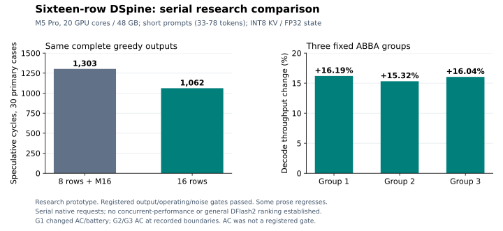

# DSpine investigation, November 10, 2026

The strongest qualified result uses the draft's trained sixteen-row block:
**15.3–16.2% higher serial native decode throughput** than eight-row DSpine with
the M16 policy, across three fixed ABBA groups. All complete output arrays,
operating gates and per-case noise gates passed. This is a research prototype.
The serving implementation on this PR still uses eight rows.



The evidence supports a geometry and kernel implementation project before more
precision tuning. Wider verification pays on many coding/structured requests,
but exposes an expensive 64-row gate/up kernel at concurrency. Several prose
requests gain little acceptance and become slower. This study does not establish
a general ranking of DSpine and DFlash2.

## Scope and reproducibility

Research window: November 10, 03:18:48–11:18:48 UTC. One M5 Pro, 18 CPU cores,
20 GPU cores, 48 GB, macOS 26.6, Metal 4. Power source varied between AC and
battery; round-boundary receipts are retained. One owned GPU job at a time;
no heavy builds inside controlled timing groups; other applications were not
stopped. Hardware sampling begins at 03:21:19 UTC, about 2m31s after the
research window starts; initialization before that is not covered. The final
trace audit records actual coverage and sampling gaps. The 18 supplied
previous DFlash2 study directories were read as
references and preserved. Source base is
`33a488d4bbb3978b32b34e8bfc6cefa92e350d7f`; patches are independent full diffs
against that base. The benchmark draft-window fix was separately committed as
`0a90d7b4caf725ee4f27afcd37f6d827d05a6300`.

| Role | Repository | Revision |
| --- | --- | --- |
| Target | `mlx-community/Qwen3.8-27B-4bit` | `10c35caafbb80f7dc6a7a432cdd11af10a6d4818` |
| DFlash2 | `incoai/Qwen3.8-27B-DFlash2` | `015e795645c74b1a0eeef3b570031fb62e769bc5` |
| DSpine | `tencent/Qwen3.8-27B-DSpine-b16` | `5f54174d301dbca65d9aa4448dc47e56732d9a12` |

Target and default draft projections use affine 4-bit groups of 64; the DSpine
bridge stays BF16. Unless explicitly varied, tests use INT8 KV, FP32 recurrent
state, ANE disabled and a 32,768-token target limit. Direct operator/dispatch
profiles use their stated fixed dimensions and dedicated page pools. DFlash2 retains its
2,048-token draft window; DSpine retains 8,192. All 66 loaded target images are
byte-identical between the drafter installations. The status field
`target_model_sha256` includes prepared-installation provenance and is not a
hash of target tensor bytes alone.

`cohort31.txt` reuses a historical DFlash2 corpus: 30 primary cases plus the
predeclared `count_secondary` control. It is not a new independent benchmark.
Primary output length is 6,523 decode tokens. A fresh twelve-case cohort was
frozen before its first use and used once. Code/prose/structured/multilingual
output agreement is checked; there is no human quality grading.
The 31-case corpus has short prompts of 33–78 tokens and output caps of
384–1,024; the twelve fresh prompts have 46–85 tokens and 256–512 caps. The
qualified serial result therefore does not establish long-context speed.

A separate native long comparison uses repository-source excerpts:
`runtime_cache` (8,193 prompt tokens, cap 256) and `draft_tests`
(16,385 tokens, cap 384). Its original four-case protocol was narrowed to
these two endpoints at 09:56:36 UTC, before any run/output from those four
prompts, because observed cooling waits threatened completion inside the
eight-hour window. `resource_json` and `arena_tests` were not executed.
All twelve ABBA rounds and strict gates stayed unchanged. The original four
prompts and protocol are archived. Decode excludes prefill/first-token time;
this endpoint alone cannot establish cold-request completion latency.

The prior DFlash2 studies informed the experiments, rather than supplying
DSpine speed claims. The safe-M16 selector was retested on this base and did
not qualify alone; the historical 31-case corpus came from the tree-certificate
study and stays calibration data. Earlier true-sixteen DFlash probes used an
eight-trained draft, unlike this sixteen-trained checkpoint. GDN storage and
projection-sharing ideas received independent numerical checks and retained
negative screens. Prompt-lookup/tree/prefix-packing gains were not assumed to
transfer to DSpine.

## Results and causes

| Experiment | Primary cycles, same 31 outputs | Interpretation |
| --- | ---: | --- |
| DFlash2 eight-row + M16, 4-bit draft | 1,339 | Separate drafter, common outputs |
| DSpine eight-row, 4-bit draft | 1,303 | DSpine control |
| 3-bit draft | 1,321 | More cycles |
| 8-bit draft | 1,291 | Small acceptance change |
| Native BF16 draft planes | 1,289 | Small acceptance change; not full MLX BF16 arithmetic equivalence |
| Upstream bridge double rounding | 1,305 | Fidelity change, no acceptance improvement here |
| Sixteen-row draft/verification | 1,062 | 18.5% fewer cycles |

Precision timings are unpaired screens and do not establish speedups. Higher
precision increases weight traffic. The BF16 native path preserves stored BF16
values but uses native staging and arithmetic; it is not a reproduction of the
upstream BF16 training target. Draft quantization is not the main demonstrated
cause of the eight-row acceptance gap.

The existing M16 selector change alone measured +1.61%, +1.74%, +2.07% in three
serial ABBA groups. All output/noise/operating checks passed, but the first two
groups missed the registered 2% minimum effect. **It did not qualify.**

Sixteen rows versus eight-row M16 passed the registered gates at +16.19%,
+15.32%, +16.04%. Power changed during group one; the registered operating
gates did not require AC. The later groups provide separate corroboration,
while these measurements do not isolate power-source effects.
Across those group means, recorded decode wall per cycle rises only about
5.9% (70.36 → 74.51 ms), while decode tokens per recorded cycle rise about
22.7% (5.01 → 6.14). That decomposition explains the aggregate speedup without
assuming twice the draft width means twice the throughput. It includes terminal
and partial cycles and is not an isolated GPU-cycle measurement. The prototype
also adjusts required path/partition choices; it is not a width-only experiment.

Some prose cases had about 3–6% lower mean throughput. The fresh twelve-case cohort had all
outputs identical across DF8, DS8 and DS16; primary cycles were 1,253, 1,251
and 1,102 respectively. Its timings are single unpaired observations.

At fixed continuation prefixes, 66 of 67 eligible primary cases agreed on the
first seven accepted proposals between eight and sixteen rows. One accepted
six versus seven. Causal architecture therefore does not imply bitwise prefix
agreement across different numerical geometries. Equal-prefix mean emitted
tokens per first cycle were 5.94 versus 9.51; this is neither an independent
sample nor a throughput forecast. The actual cycle-weighted ratio was only
1,303/1,062 = 1.227.

A subsequent **DF8/DS8/DS16 matched-anchor check** uses the same frozen
71 prefixes (67 eligible primary, four count controls). All 71 complete
18-token continuations agree. Equal-prefix mean first-cycle output counts
are **5.955 / 5.940 / 9.507**; equal-task means are **6.181 / 6.067 / 9.983**.
DS8 has eight higher, eight lower and 51 equal accepted-prefix counts versus
DF8. Both windows cover every short prefix (at most 429 tokens). This does
not establish a general eight-row DSpine acceptance deficit, or measure the
benefit of its longer context window. Overlapping calibration prefixes are
not independent production samples; no CI or TPS forecast is attached.

[Community feedback by sady4850](https://github.com/incoai/splash/pull/731#issuecomment-6761876716)
reports stronger DSpine acceptance on 43 real-agent traces in a different
A100/reference setup, plus a separate M1 quantization probe. Those are
author-reported observations, unverified here; the comment does not supply
the raw traces. They motivate independently frozen agent-history workloads
and native/reference conditional-probability checks at identical captured
features and anchors. Their ratios are not combined with our M5 timings.

At batch four, sixteen rows create 64 physical verify rows. The original M64
fused gate/up accounted for about 185 ms of a 306 ms attributed cycle.
Independent row subdivisions cut the operator from about 2.6–2.7 ms to
0.87–0.89 ms; the existing two-pass path was competitive or faster in the
initial screen. These profiles change dispatch scheduling and are diagnostic,
not controlled request throughput measurements. Register pressure is a
hypothesis; register spills and DRAM traffic were not measured.

The fixed HTTP comparison of original wide gate/up against existing two-pass
showed 56.8–64.4% higher concurrent throughput descriptively, but two of three
groups failed strict output equality. A same-binary diagnostic reproduced both
hashes: merge-sort output changes with physical batch width at token 189 under
both policies, while old/new outputs match at every fixed width. This explains
that fixture failure without making the HTTP qualification pass.

The direct **short-corpus native DF8+M16 versus DS16** comparison is also
**not qualified**. Aggregate TPS was 68.50→81.01, 68.16→80.85 and
68.01→80.85 in its three groups: +18.26%, +18.62%, +18.87% descriptively.
Every complete output array and registered operating check passed. Aggregate
spread was 0.81%, 0.32%, 0.19%, but maximum per-case spread was 8.38%, 6.68%,
3.37%; groups one and two therefore fail the 5% all-case noise gate.
DF8 needs 1,339 cycles and DS16 1,062 in every round; the earlier DS8
control needs 1,303. Both draft windows cover the entire short continuations,
so their window-length difference does not explain these short-case counts.
The final group passes, which does not make the full three-group experiment
pass. No group is repeated. This differs from the earlier four-coding-prompt
HTTP corpus and cannot replace its result or establish a general ranking.

The **two-case long native comparison qualifies** at **+6.98%, +6.09%,
+6.04%** aggregate decode TPS across its three fixed groups. DF8+M16 versus
DS16 rates are 50.51→54.03, 51.01→54.12 and 51.00→54.07 tok/s. All
outputs, per-case noise and operating gates pass. The 8K prose case regresses
3.42–3.49%; the 16K code case improves 16.88–18.84%. Cycles are 87→80
and 89→67 respectively. This is a narrow two-task result, not a general
long-context drafter ranking. All these rounds stayed on battery at recorded
boundaries.

Cold prefill/first-token means, descriptive only, are 15.195→15.261 seconds
for the 8K case and 33.440→33.573 seconds for the 16K case. Summed recorded
request-wall means are 61.185→60.633 seconds, only **+0.91%** total-request
throughput descriptively; model initialization is outside that wall. The
registered speedup applies to decode, not cold end-to-end latency. This
supports separately testing prefix reuse for repeated long agent prompts.

The separate DF8-versus-DS16 HTTP comparison was inconclusive in all three
groups, with 11–46% endpoint spread and batch-width output variation. Runtime
GPU frequency/power varied even under nominal thermal state. Idle observations
did not establish foreign GPU activity; no process was blamed or stopped.

A raw target-logit probe separately forced the same continuation at physical
widths 1–4, with each lane individually prefilling the same prefix. At the
previously observed output position 189, width one preferred `comes` by
0.0219 logits, while widths two through four preferred `is` by 0.0848. Those
widths agreed on the other 16 tested argmaxes. Cold prefill recomputes preceding
GDN state, so the direction reverses the original natural-decode example; this
is a numerical mechanism check, not a reproduction of its exact states or an
identification of a single responsible operator.

Round-boundary `pmset` receipts reveal AC/battery transitions; power was not
continuously sampled. The final direct comparisons started on battery. No
round is dropped or repeated because of that observation. Consult
`results/power-source-audit.json` in the evidence archive alongside each
registered verdict; an ABBA pass does not by itself rule out power-source
confounding.

Additional final kernel, sampling, lifecycle and direct native comparison
results are recorded in the accompanying result index and evidence.

The completed sampling screen used **9,000 cold B1 requests**: 1,500 independent
seeds per arm/context, three contexts and an 18-token cap. None of the 78 tests
rejected after Holm correction over the reserved 234-test family; 73 tests were
informative and five degenerate. The minimum raw p-value was 0.1594 and all
adjusted p-values were 1. All requests reached the cap, so this checks early
tokens and selected adjacent pairs, without exercising EOS termination or
long-range distribution changes. The portable analyzer reproduces the complete
original statistical record exactly.

Under Metal shader validation, sixteen-row serving passed a **15,928-token**
cold prompt, exact warm reuse and a suffix request. A clean restart restored
15,904 cached tokens from disk with identical suffix output. A separate native
priority test observed actual suspension, replay and resumption in all five
cases, including a 15,246-token prompt: replay counts were 20, 16, 19, 19 and 21
tokens, and all four complete 256-token clone outputs matched in every case.
This validates priority-driven replay; the earlier synthetic memory-pressure
probe did not trigger suspension and remains a failed test of that mechanism.

A pinned MLX comparison used identical **4-bit target source files**, 96 cold
prefill positions and 33 forced next-token logit rows. Native eight/sixteen
captures and forced logits were bit-identical within each KV format. The
intended capture layer matched MLX more closely than either adjacent layer at
all five taps. Native BF16-KV versus MLX relative feature RMS error ranged from
0.37% to 3.43%; all 33 logit argmaxes matched. This supports the capture-index
alignment in this probe, while leaving numerical drift visible. It does not
compare against the original BF16 training target or explain DSpine acceptance
by itself. Cold short-request context KV is computed directly from BF16
projected features; cached-window compression is not used on that cold path.

The ordinary-projection row-sharing prototype passed 2,293,760 bitwise
comparisons and 5,760 independent FP64 interval checks across all four epilogues,
padding and split-counter reuse. Its operator wins depended on shape and K
partition count. Direct CPU plan inspection found that the deployed MLP shape
uses **one** partition; an apparent gain at two did not beat that existing plan.
A proposed two-partition scope therefore selected no new kernels in its pilot
profiles and was withdrawn from qualification. All inactive-selector and broad
prototype results are retained. No improvement is claimed from those unpaired
timings.

## Implementation plan

1. **Support per-model eight/sixteen geometry.** Carry explicit active geometry
   through descriptors, runtime plans, sampling, tapes, accounting and pipeline
   identities. Keep DFlash2 at eight rows. The prototype's global macro and
   register-path disable are research shortcuts. The sixteen-row native budget
   leaves about 260.7 MiB less dynamic memory; do not impose this cost on every
   eight-row model.
2. **Repair or reject unsupported Table16 layouts.** The Table16 matrix layout
   is physically eight rows. The full sixteen-row GDN test finds an out-of-bounds
   store at byte 18,432 in an 18,432-byte buffer. Host sum allocation also divides
   by the global verification width. Correct all producer/consumer offsets for
   two eight-row tiles, or explicitly disallow the layout. The separate plain16
   oracle passes; that does not validate Table16. No tolerance was relaxed.
3. **Calibrate wide gate/up independently.** Compare existing two-pass and shared
   weight-stage row subdivisions with unchanged K splits, on measured device
   and shape ranges. Production selection needs device/shape policy and plan
   tests rather than research environment variables.
4. **Then test adaptive width.** Start with batch-dependent eight/sixteen
   selection; add accepted-prefix history and measured cycle cost only after
   both geometries are supported. Use existing completion counts, hysteresis
   and a minimum observation window. Include switching, memory, fairness and
   long-cache costs. Freeze calibration before a new held-out workload.

On the controlled short corpus, perfect zero-overhead whole-task selection in
hindsight adds only **1.51% throughput over fixed sixteen rows**. That estimate
uses the same calibration means and does not bound per-cycle adaptation or
long/concurrent traffic. It favors batch-dependent cost policy before a complex
per-task classifier.

The proposed geometry contract separates capacity from execution and table
packing:

| Contract | DFlash2 serving path | Fixed sixteen-row DSpine |
| --- | ---: | ---: |
| Active rows per request | 8 | 16 |
| Required row capacity | 8 | 16 |
| Contiguous transient matrix rows | `batch × 8` | `batch × 16` |
| Persistent pending-tape row stride | 8 | 16 |
| Table16 packing tile | 8 | 8; two tiles per request |
| KV page tokens | 32 | 32 |

Adaptive DSpine would retain capacity sixteen while rebuilding transient views
for the active width. Its pending-tape stride must remain independent: changing
a global row count would otherwise reinterpret another lane's data. Cache
payloads need an explicit compatible layout or a versioned identity. Initially
allowing only the validated staged layout is a viable scope guard; a broad
register-path rollout needs the Table16 producer and every consumer repaired.

A width transition has an additional replay contract: after a sixteen-row
step, an eight-row step can inherit 9–16 accepted rows still pending in GDN
state. Replay capacity must remain sixteen independently of the next active
width, or switching must explicitly commit that state and include its cost.
Test every pending count and both switch directions with lane reorder and
suspension. GPU result structs also need a common capacity/ABI: two global
macro builds currently give different per-lane token-array offsets, so merely
loading both libraries would not make host reads safe.

The register consumer also needs a separate tile count: its `_l1`–`_l4`
variants mean one through four **eight-row tables**. At sixteen rows this
covers B1/B2 as `_l2`/`_l4`; B3/B4 need a staged fallback unless new variants
are independently implemented and qualified. Removing the prototype
register-disable alone would silently dispatch too few rows. On this M5, the
existing register threshold selects only small projections, so packing repair
is a safety requirement rather than a demonstrated large speedup.

One adaptive design to evaluate is keeping the draft query at its trained
sixteen rows while verifying either eight or sixteen target rows. That avoids
switching draft-query geometry, but spends work on unused proposals and needs
independent draft/verify strides and sampler bounds. It is an unmeasured design
option; the existing eight-row proposal measurements cannot predict it exactly.
The production geometry work should also preserve existing eight-row selector
defaults: the separate M16-policy experiment did not qualify on its own.

KV pages remain 32 tokens. Geometry qualification must cover 31/32/33 and
8,191/8,192/8,193 boundaries, compaction, suspended replay and disk restore.
One GPU/model/precision setup cannot establish cross-device support.

At 8K context in the single B1 dispatch profiles, DF8/DS8/DS16 fused GPU
cycles were 69.13/75.51/85.29 ms, and their attributed draft-attention families
were 0.343/1.057/1.791 ms. Projection families dominate; smaller draft windows
therefore look less promising than useful verification work and wide-kernel
selection. Attributed profiles change scheduling and do not add exactly to
fused timings, so these numbers are diagnostic rather than a speedup bound.
Window shortening still needs its own acceptance test.

For agents dominated by repeated prompts, separately test guarded cache
junctions and prefix packing from the prior studies. Preserve DSpine
8192-token restore/capture plans and bridge state; a DFlash 2048-token
threshold cannot be carried over without checking those plans. Measure
materialization plus later reuse, retained memory and client completion time,
including checkpoint creation cost. The long HTTP lifecycle pass here proves
functional reuse/restore only, not an end-to-end cache speedup.

Lower-priority avenues include more bridge/refinement fusion (small remaining
cycle ceiling), a separate low-bit initial proposal head (about 530.5 MiB extra
for 3-bit, no B3/B4 gain in the screen), and draft-window reduction (acceptance
cost not established). Smaller threadgroup storage alone is not evidence of
higher occupancy. Apple's per-threadgroup memory limit is not a per-core
residency budget.

A late **packing-only Table16 repair** passed the complete sixteen-row GDN
suite under Metal shader validation (68.4 seconds), including Table16, replay,
buffer extents and BF16-state comparisons. It allocates sums per eight-row
tile, writes GDN tables using global row → tile/local-row mapping, and makes
the existing test reference prepare both tiles. Numerical tolerances are
unchanged. The original failed trial is retained. This follow-up keeps
register selection disabled: consumers/selection and per-model geometry still
need implementation and qualification; no application speedup is claimed.
`followups/table16-layout-followup.patch` is the full source against the
recorded base; `table16-packing-only.patch` is the three-file review delta
against the wide-policy variant.

## Rebuild and inspect

Use a checkout containing the base commit and a fresh output directory on a Mac
with the recorded Metal 4 toolchain. `MODEL_ROOT` is an installed Splash root
for the pinned target plus DSpine draft, containing `model.json`. Never point
the sixteen-row variants at DFlash2.

```sh
python3 reproduce.py build --repo /path/to/splash --output /tmp/dspine-repro \
  --variant wide-policy
python3 reproduce.py run --output /tmp/dspine-repro --variant wide-policy \
  --mode oracles --shader
python3 reproduce.py run --output /tmp/dspine-repro --variant wide-policy \
  --model-root MODEL_ROOT --mode cohort --env SPLASH_GATE_UP_TWO_PASS64=1 \
  --name wide-greedy
```

The packing-only follow-up has a separate full-source rebuild, without
model tensors:

```sh
git -C /path/to/splash worktree add --detach /tmp/dspine-packing \
  33a488d4bbb3978b32b34e8bfc6cefa92e350d7f
git -C /tmp/dspine-packing apply /path/to/followups/table16-layout-followup.patch
make -C /tmp/dspine-packing -j6 all build/engine-tests/gdn-decode
MTL_SHADER_VALIDATION=1 /tmp/dspine-packing/build/engine-tests/gdn-decode \
  /tmp/dspine-packing/build/splash.metallib
```

Every variant patch is independent; do not stack them. `control` is eight-row
PR code plus the benchmark window fix. `m16-policy` adds the selector change.
`block16` is the original geometry experiment. `wide-policy` adds the host-only
two-pass control and corrected plain16 oracle fixture. Other names identify
the precision, bridge, head, independent/shared gate/up and GDN experiments.
Research environment settings are opt-in and are not proposed serving defaults.

To recompute native gates from the supplied compressed evidence:

```sh
mkdir /tmp/dspine-evidence
tar -xzf evidence/evidence.tar.gz -C /tmp/dspine-evidence
python3 analyze_native.py /tmp/dspine-evidence block16-vs-m16-abba \
  --output /tmp/dspine-native-verdict.json
```

The native standalone analyzer reproduces all four saved comparison verdicts
and every boolean gate exactly. Numeric fields differ by at most
5.33e-15 across Python 3.9/3.14 float summation; the audit uses 1e-12 numeric
equivalence without changing any qualification threshold. Sampling records
are exactly reproduced. The analyzer requires all three saved groups and
retains every failure/noisy
round. Qualification requires identical full arrays, operating checks, every
case/control spread at most 5%, and aggregate latency improvement strictly
greater than `max(2%, 2 × endpoint spread)`. A normal non-regression pass is not
enough to call an improvement.

`analyze_sampling.py` requires the pinned NumPy/SciPy environment in
`requirements-analysis.txt`. It consumes the same extracted evidence root and
an `--output` path. Sampling uses independent seed arms, 1,500 seeds per context,
three contexts, an 18-token cap and a pre-data nomination barrier. Pearson
chi-square with symmetric rare-category pooling and Holm correction across
234 reserved tests is a finite regression screen; non-rejection does not prove
equivalence. See the frozen protocol for positions, adjacent pairs and limits.

`source-manifest.json` pins the public reproduction sources.
`evidence/evidence-manifest.json` pins the original outputs, receipts, scripts
and separate hardware trace. Failures, invalidated builds and inconclusive
trials are retained. Model tensors, executables, cache contents and large raw
feature arrays stay local; relevant source and output digests are retained.

## Primary references

- [Tencent DSpine bridge source at the inspected commit](https://github.com/Tencent/DSpine/blob/321b0fc1388c4cdf03483ab73856975f7c0c0be7/dspine_mlx/dspine_mlx/bridge.py)
  supports the double-rounding fidelity check; it does not predict acceptance.
- [Apple Metal Performance Primitives guide](https://developer.apple.com/download/files/Metal-Performance-Primitives-Programming-Guide.pdf)
  motivates profiling tile and shader-local storage tradeoffs. Dense GEMM
  guidance does not establish an optimum for these quantized kernels.
- [Metal per-threadgroup memory limit](https://developer.apple.com/documentation/metal/mtldevice/maxthreadgroupmemorylength?language=objc)
  defines the allocation limit, rather than resident groups per core.
- [SciPy contingency-test documentation](https://docs.scipy.org/doc/scipy/reference/generated/scipy.stats.chi2_contingency.html)
  describes the asymptotic sampling test used here.
