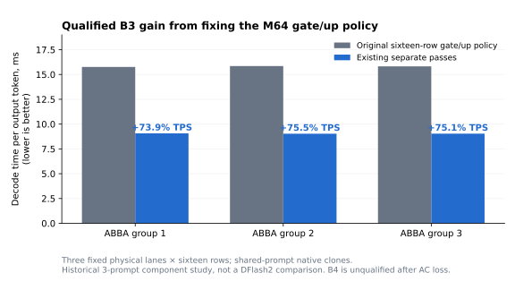
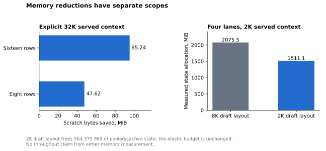
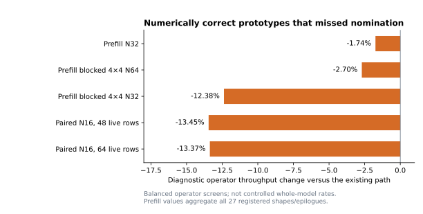
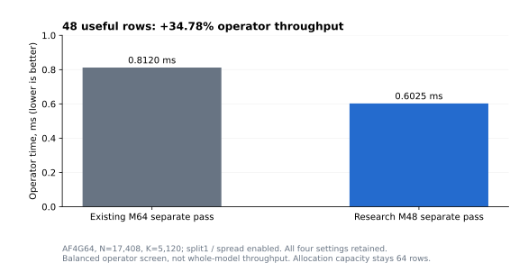

# DSpine follow-up, November 10–11, 2026

This follow-up implements fixed per-model eight/sixteen-row DSpine execution,
with **eight rows still the default**. It repairs the physical eight-row Table16
contract, carries active geometry through runtime/state/sampling/accounting,
and compiles both row-sensitive shader variants into one library. DFlash2 stays
at eight rows. Sixteen-row execution rejects unsupported routed, sparse-KV and
auxiliary-state models.

## Final comparisons

| Control → candidate | Decode tok/s | Decode change | Request-wall change | TTFT change | Verdict file |
| --- | --- | --- | --- | --- | --- |
| Committed DSpine (8 rows) → final DSpine (8 rows), three historical cases | 71.1–71.2 → 71.0–71.1 | Passed non-regression (-0.33% to -0.06%) | Passed non-regression (+0.08% to +0.44%) | Unqualified (+0.26% to +3.18% observed) | [JSON](results/default8-final-v1.comparison.json) |
| Committed DSpine (8 rows) → final DSpine (16 rows), 31 historical cases | 63.1–64.3 → 79.4–79.6 | Unqualified (+23.81% to +25.78% observed) | Unqualified (-20.38% to -19.09% observed) | Unqualified (-7.51% to -5.59% observed) | [JSON](results/dspine16-final-v1.comparison.json) |
| DFlash2 → DSpine (16 rows), 31 historical cases | 63.4–63.5 → 79.5–79.7 | Unqualified (+25.32% to +25.61% observed) | Unqualified (-20.21% to -20.03% observed) | Unqualified (-5.95% to -5.88% observed) | [JSON](results/dflash8-vs-dspine16-final-v1.comparison.json) |
| DFlash2 → DSpine (16 rows), four cloned lanes | 240.1–240.6 → 149.6–150.6 | Qualified (-37.81% to -37.43%) | Qualified (+57.17% to +58.06%) | — | [JSON](results/dflash8-vs-dspine16-b4-final-v1.comparison.json) |
| DFlash2 → DSpine (16 rows), 12 synthetic agent prompts | — | Unrun (0/12 rounds) | Unrun (0/12 rounds) | Unrun (0/12 rounds) | [JSON](results/agent12-dflash8-vs-dspine16-final-v1.comparison.json) |
| M64 → M48, three cloned sixteen-row lanes | — | Unrun (0/12 rounds) | Unrun (0/12 rounds) | — | [JSON](results/m48-b3-research-v1.comparison.json) |

Decode rates show the control and candidate ranges across the three groups, aggregating tokens across lanes in the clone fixtures. Decode percentages measure candidate throughput relative to control. Request-wall and TTFT percentages measure elapsed time, so negative values indicate shorter waits.

For Committed DSpine (8 rows) → final DSpine (16 rows), 31 historical cases, group 1 had 9 cases with differing complete output arrays and 4 cases above the 5% decode spread limit, group 2 had 9 cases with differing complete output arrays, group 3 had 9 cases with differing complete output arrays.

For DFlash2 → DSpine (16 rows), 31 historical cases, group 1 had 9 cases with differing complete output arrays, group 2 had 9 cases with differing complete output arrays, group 3 had 9 cases with differing complete output arrays.

The protocol for DFlash2 → DSpine (16 rows), 12 synthetic agent prompts remained unrun at the research cutoff.

The protocol for M64 → M48, three cloned sixteen-row lanes remained unrun at the research cutoff.

The serial audit covers 1,488 complete arrays. Committed eight-row DSpine and final DFlash2 match on 31 of 31 prompts. All three arms agree on 22 prompts. Every arm reproduces its complete array on each repetition. [Three-arm audit](results/historical-greedy-arms-v1.json)

The final eight-row functional pass uses the same recorded driver, Metal library, DSpine layout, cohort and greedy settings as the timed sixteen-row arm. It matches the committed eight-row control on 31 of 31 prompts and differs from the final sixteen-row arm on 9. This gives a same-build starting point for matched-prefix logit probes. [Same-build output comparison](results/historical-same-build-width-v1.json)

In the timed comparison with the committed eight-row source, first differences span indices 42–404 (zero-based). Output lengths differ on 5 prompts, with -46 tokens across one pass through the cohort. [Output audit](results/dspine16-output-divergence-v1.json)

The serving source was chosen at 18:17:49 UTC, before any output from the new
agent or sampling cohorts. Full integration validation precedes opening them.
Each protocol schedules three ABBA groups and retains failed, noisy and
interrupted trials. Each group runs control, candidate, candidate, control.
Every complete greedy array, artifact identity, operating gate and registered
case is checked. The effect gate uses the relative change in time per token
for decode and elapsed time for the latency endpoints. It requires a change
larger than `max(2%, 2 × endpoint spread)`, with case and aggregate spreads
at most 5%.
The default-eight comparison has a separate non-regression criterion. Decode,
cold request wall, TTFT and registered context categories have separate gates.
Serial request walls include cold prompt prefill after model bootstrap. The B4
clone fixture uses a warmed shared prefix. Its request-wall timer starts after
prefix materialization.

The historical 31-case corpus has 30 primary cases and a predeclared
`count_secondary` control. It reuses calibration data from the prior studies.
The registered agent corpus is designed to test performance and exact outputs on twelve original
synthetic software and tool histories. It has four short prompts, four around
4K and four around 16K tokens, each capped at 256 outputs. Fixed-width cloned
lanes measure shared-prompt native capacity.

## Kernel and memory changes

Selecting the existing separate gate/up passes for the sixteen-row M64 tile
improves B3 decode throughput by **73.9–75.5%** against the original paired
M64 policy at the same width. The B4 component comparison lost AC power in
its third group and remains unqualified.



Attention scratch is smaller by **95.238 MiB** in sixteen-row mode at an explicit
32K served context. A separate allocation fixture on battery freed **564.375
MiB** of pooled and cached state at a 2K served context by selecting the
already compiled 2K draft window. The elastic budget stayed fixed.



The cycle profiles and output counts explain the projection cost at wide
batches. [Mechanisms and next experiments](MECHANISMS.md)

## Source and validation

The production patch is relative to committed baseline
`425ad7400f3a00d2a1e6745bdacfa2881922d544`. Its source commit is
`17a0ae2454ef567a599ccd64373d25fc7df9313b`, patch SHA-256
`ec4254095b3f16ed843de824622d727164005cd70c6844c3f180c0278f752736`.
The final source manifest and executable/library hashes are retained alongside
the frozen protocols and receipts. The selection and nomination records track
the source choice and subsequent validation. Integration follow-ups end at
`fb429642850299f81def93e730b84131fb075cde`.
They add the parser-default test fixture and CLI/status documentation, localize
two existing Swift expected strings, and keep draft width with model-specific
CLI options. The desktop app uses the default DFlash2 draft. A supplemental
byte witness checks the allowed changes against the frozen source and verifies
the hashes of the timed production binary and library.

All **23 registered validation gates passed** before final comparison arms
opened. This includes production/native CPU builds, the full repository Metal
recipe under shader validation, full host ASan/UBSan/TSan and the full Metal TSan
recipe with the repository's declared suppressions. Full Python discovery ran
1,606 tests successfully with 30 skips. Swift passed 134 tests with the
existing opt-in suites skipped. Configured Python compile, lint, format and
architecture checks passed.

Finite integration fixtures cover the three drafter/width smoke paths, B3/B4
clones, a 32,758-token prompt at an unaligned 32,760-token context limit, five
actual priority suspension/replay cases, HTTP service checks, eligible long
SSD-cache reuse and four physical cache namespaces. All 31 default-eight
historical arrays match the committed baseline (7,577 returned tokens). The
nine-run SSD fixture confirms old/new eight-row disk takeover and repeated
sixteen-row restores. Its short 2K cases exercise namespace isolation and cold
restart below the 2,048-token write-behind threshold.

Initial failures include missing parser-default and UI integration fixtures,
a pyenv interpreter whose external `libintl` dependency the PDF sandbox blocks,
two Swift assertions hardcoding US digit grouping on an Indian-locale host and
a disk-cache fixture below the write threshold. The full Python rerun used
isolated uv CPython 3.14.7 with the repository's pinned requirements and
original sandbox policy. The Swift assertions now use locale-aware expected
text. The disk fixture uses a prompt above the threshold.

The final CLI and app scope correction passed the full 134-test Swift run and
the affected Python launch-option contract between complete comparisons. Its
validation record checks the allowed changes against every frozen source byte
and production artifact.
[Validation gates](results/final-validation-v1.json)
[Integration check](results/final-integration-v3-validation.json)
[Source witness](results/integration-source-witness-v3.json)

The register path's `_l1`–`_l4` names mean one through four **eight-row physical
tables**. Sixteen-row B1/B2 use `_l2`/`_l4`. B3/B4 have a staged fallback.
A permanent `gguf-projection --register16` mode exercises representative
AF4G64, Q4_K, IQ4_XS and BF16 layouts, both supported lane counts, valid K splits,
padding, split counters and independent FP64 bounds. Existing eight-row tests
remain in the suite. Common maximum-capacity control structs use explicit ABI2
entry names, so mismatched older shader libraries fail lookup.

The wide policy selects separate passes for sixteen-row AF4G64 MLP
gate/up at `N=17408, K=5120`, physical M64, on the measured Apple10/20-core
calibration. K partitioning and traversal stay unchanged. Other device/format/
shape/width choices retain their existing policy. The B3 qualification,
guarded numerical checks and two clean B4 groups support this opt-in policy.
Complete B4 component performance remains unqualified.

After building this branch, run the CLI with the desired model and width.

```sh
splash serve --model mlx-community/Qwen3.8-27B-4bit \
  --draft-model tencent/Qwen3.8-27B-DSpine-b16 \
  --draft-block-size 16 --max-context 32768 --disable-ane
```

The width is fixed for that runtime.
Sixteen-row persistent state has a separate namespace. The default-eight
namespace remains compatible with the committed baseline. A served context of
at most 2K selects a distinct short-window state layout. Larger and automatic
contexts use the checkpoint's 8K draft window.

## Numerical and negative results

An 8,193-token historical prompt exposes a cold/warm mismatch at output index
34 with an actual 8,128-token cache hit plus 65 replayed tokens. The committed
eight-row baseline reproduces it, as do the new eight/sixteen paths and DFlash2.
The baseline's top-two logits there differ by only about 0.019. A full-prompt
seed gives an actual 8,192-token hit plus one replay token. Cold and warm
arrays and fourteen selected full-vocabulary rows match bitwise within
each tested width. Eight/sixteen cold arrays still diverge at index 34.
The original failures remain in the evidence. The replay-length change
motivates a matched-prefix comparison of pre-policy target logits.

On identical captured final-layer inputs, the pinned MLX exact-sender tail and
native execution agree on every argmax and same-uniform sample choice across
seven conditional positions at eight rows and fifteen at sixteen rows (22 total). Maximum
total variation is `8.64e-5` at eight rows and `3.59e-4` at sixteen. The scope is
the conditional tail of one historical prompt's first sampled block at each
width. The arithmetic comparison is descriptive. The MLX full-model loader
at `321b0fc1388c4cdf03483ab73856975f7c0c0be7` rejects this checkpoint's
sliding-window configuration.

Three prefill tile variants and the N16 paired gate/up prototype passed their
corrected numerical screens but missed prospective speed thresholds. Prefill
geometric operator changes are −1.74%, −2.70% and −12.38%. The two primary N16
cases lose about 13.4%. Direct cooperative-register AF4 input also loses to the
best existing path at every tested production shape. Initial invalid fixtures
and their corrections are retained with the research sources.



The format-specialized fused projection passed functional and oracle checks.
Its optional full-model comparison stopped at the AC launch gate before
measurement. Static threadgroup storage was recorded. Registers, spills and
occupancy remain open measurements.

A separate M48 prototype computes the 48 live rows of three sixteen-row lanes
while keeping the existing 64-row plan/allocation capacity and K splitting.
The prospective primary operator screen improves from 0.8120 to 0.6025 ms
(**+34.78% operator throughput**, −25.81% latency). Both variants use 8,208 bytes
of static threadgroup memory. Two small cases pass 196,608 bitwise checks and
432 independent FP64 comparisons. The production shape passes 10,027,008
bitwise comparisons across four registered split and spread configurations.
[M48 implementation and qualification plan](M48_NEXT.md) gives the exact guard,
permanent-test requirements and a research rebuild command.
Its guarded production graph matches nine complete cloned-lane arrays, with
exactly 69 separate AF4 gate and 69 up calls at B3, and no M48 calls at B1/B2/B4.
The research patch and measurements belong to a separate source snapshot.



The comparison with the corrected M64 path appears in the final comparisons table. [Whole-model verdict](results/m48-b3-research-v1.comparison.json)

## Independent-seed sampling screen

The research cutoff interrupted the final control chunk. The screen ended with 0 of 280 reserved tests evaluated. The remaining 280 tests retain the prespecified p = 1 assignment for unobserved tests. The full screen is incomplete. Progress journals recorded 11,604 completed requests across all started chunks. The length audit covers 10,000 requests from complete chunks. Of these, 4,310 ended below the cap, including 0 with zero output tokens. [Sampling verdict](results/sampling4-comparison-v1.json) [Output length audit](results/sampling-termination-v1.json)

The protocol reserves 280 Holm-corrected tests over four contexts, 24 token
positions, ten adjacent pairs and output length for each of two candidate
comparisons. The prompts are 30–43 tokens long. Each arm uses an independent
fixed range of 1,000 seeds per context, temperature 1, top-p 0.95, top-k 20 and
a 24-token cap. The comparisons use committed eight-row DSpine as control,
with sixteen-row DSpine and DFlash2 from the final build as candidates. All
three artifacts were nominated before the first fresh sampled output.
Positions after termination use absorbing STOP, including all positions for
zero-length outputs. Rare categories are pooled symmetrically before Pearson
tests. The finite screen covers the sampled positions, adjacent pairs and
lengths at this resolution. The protocol retains incomplete arms.

## Machine, models and operating scope

The research window spans **2026-11-10 12:24:13 to 2026-11-11 01:24:13 UTC**, thirteen
hours on an M5 Pro, 18 CPU cores, 20 GPU cores, 48 GiB, macOS 26.6, Metal 4.
Builds use the macOS 27.2 SDK / Metal toolchain 27.2.47, deployment target 26.4.
One owned GPU job runs at a time. Heavy builds/analysis stay outside controlled
timing.
Continuous hardware sampling is separate from each controlled round's
five-second AC/thermal observations and idle launch gate.
The hardware trace begins at 12:28:24 UTC, about 4m12s after the research window
starts.

AC was lost during B4 group three at the first sampled non-AC observation,
17:35:02 UTC. The user reconnected power and AC was confirmed before final
comparisons. The archive retains the interrupted B4 and format-specialization
experiments.

The hardware trace contains 23,119 samples through `2026-11-11T01:24:12.919692+00:00`, with a largest inter-sample gap of 2.101 s. The final sample is 0.080 s before the deadline. The trace records 0 gaps over five seconds. [Coverage audit](results/telemetry-final-v1.json)

| Role | Repository | Revision |
| --- | --- | --- |
| Target | `mlx-community/Qwen3.8-27B-4bit` | `10c35caafbb80f7dc6a7a432cdd11af10a6d4818` |
| DSpine | `tencent/Qwen3.8-27B-DSpine-b16` | `5f54174d301dbca65d9aa4448dc47e56732d9a12` |
| DFlash2 | `incoai/Qwen3.8-27B-DFlash2` | `015e795645c74b1a0eeef3b570031fb62e769bc5` |

| Installed draft | Layers | Draft window | Feature taps (config indices) | Additional mechanism |
| --- | --- | --- | --- | --- |
| DSpine | 5 | 8,192 (2,048 only for an explicitly served context of at most 2K) | 1, 16, 31, 46, 61 | Learned code bridge and predecessor refinement |
| DFlash2 | 5 | 2,048 | 5, 19, 33, 47, 61 | Grouped convolution and learned selector |

Both drafts have five transformer layers and use the shared full-vocabulary
head. Target and draft projections use affine four-bit groups of 64. DSpine
bridge weights and draft KV rings use BF16. Tests use INT8 target KV, FP32
recurrent state and ANE off unless explicitly labeled. The model image checks
found byte-identical target files across drafter installations. Earlier DFlash2 studies informed the
kernel, prefix replay and cache experiments. [Eight-hour study](../dspine_20261110/README.md)

## Reproduce and inspect

The repository carries the protocols, arrays and source evidence in the evidence archive and the hardware trace in a separate gzip file. The release carries `logits.tar.gz` for the prefix reanalysis. [Evidence archive](evidence/evidence.tar.gz) [Hardware trace](evidence/hardware.jsonl.gz) [Release assets](https://github.com/linson007/splash/releases/tag/dspine-13h-20261111-v1)

The small evidence archive retains original protocols, cohort tokens, commands,
receipts, complete output arrays, corrected/failed research sources and build
manifests. Large pre-policy logit arrays and the full hardware trace are separate
hashed artifacts. Model weights, executables, SDK/Apple documents and physical
HTTP cache payloads are excluded. Original absolute paths identify artifacts
in receipts. Offline analyses work from the extracted directory.

```sh
mkdir -p /tmp/dspine-evidence
tar -xzf evidence/evidence.tar.gz -C /tmp/dspine-evidence
python3 reproduce.py verify --evidence /tmp/dspine-evidence \
  --manifest evidence/evidence-manifest.json
python3 reproduce.py analyze --evidence /tmp/dspine-evidence \
  --comparison default8-final-v1 --output /tmp/default8-verdict.json
python3 reproduce.py analyze --evidence /tmp/dspine-evidence \
  --comparison dflash8-vs-dspine16-final-v1 --output /tmp/serial-verdict.json
python3 reproduce.py analyze --evidence /tmp/dspine-evidence \
  --comparison dflash8-vs-dspine16-b4-final-v1 --output /tmp/four-lane-verdict.json
python3 reproduce.py analyze --evidence /tmp/dspine-evidence \
  --comparison wide-gateup-b3-v1 --output /tmp/wide-component-verdict.json
python3 reproduce.py sampling --evidence /tmp/dspine-evidence \
  --output /tmp/sampling-verdict.json
python3 reproduce.py refinement --evidence /tmp/dspine-evidence \
  --output /tmp/refinement-reanalysis.json
```

Use `requirements-analysis.txt` for the pinned numerical and plot environment.
`refinement` recomputes the saved 22 conditional-row metrics from derived score
tables and native probabilities, support, tokens and uniforms.
`sampling`, `prefix` and `refinement` run the saved analyzers in a temporary
evidence layout. For prefix analysis, download the release's logit archive and
extract it into the same evidence directory.

```sh
tar -xzf /path/to/logits.tar.gz -C /tmp/dspine-evidence
python3 reproduce.py verify --evidence /tmp/dspine-evidence \
  --manifest evidence/logits-manifest.json
python3 reproduce.py prefix --evidence /tmp/dspine-evidence \
  --output /tmp/prefix-reanalysis.json
```

The wrapper selects each protocol's frozen analyzer version. Cross-Python
reproduction checks require exact verdicts, identities and array hashes, with
`1e-12` relative/absolute tolerance only for floating summation differences in
the saved numeric report. Missing-file diagnostics may reflect the extraction
path. Decoded token strings in the prefix report require the installed tokenizer.

```sh
gzip -dc evidence/hardware.jsonl.gz > /tmp/dspine-evidence/results/hardware.jsonl
python3 reproduce.py verify --evidence /tmp/dspine-evidence \
  --manifest evidence/hardware-manifest.json
```

[Portable reanalysis check](results/portable-reanalysis-v1.json)

On a Mac with the recorded compatible compiler, `build` creates a new worktree
at the committed baseline and optionally applies the final patch. It builds the
native CPU suite and the study driver. `--metal` also runs the full Metal
suite. Native runs require an installed Splash model root.

```sh
python3 reproduce.py build --repo /path/to/splash --output /tmp/dspine-candidate \
  --variant candidate --python /path/to/python --metal
python3 reproduce.py run --build /tmp/dspine-candidate --model-root MODEL_ROOT \
  --rows 16 --cohort cohorts/calibration-smoke3-v1.txt --shader \
  --output /tmp/dspine-functional.json
```

For a controlled replication, use the archived round scripts, artifact checks,
operating thresholds and analyzers with the new build's recorded identity.
